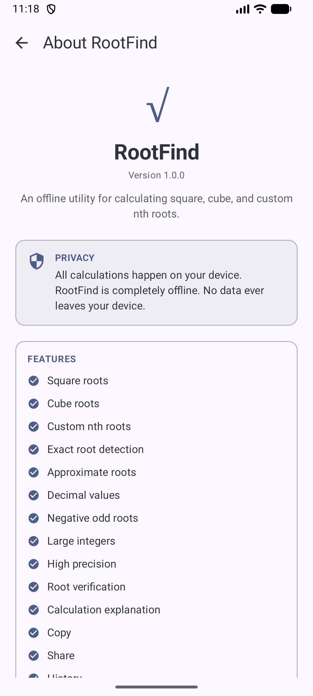

# RootFind 🧮✨

**RootFind** is a powerful, feature-rich, and modern Android application designed for precise mathematical root calculations. Built from the ground up using **Kotlin** and **Jetpack Compose** with **Material 3**, RootFind provides an intuitive, elegant, and responsive interface for computing square roots, cube roots, and arbitrary $n$-th roots with step-by-step breakdowns, decimal/integer precision control, calculation history, and comprehensive customization options.

---

## 📱 Screenshots & UI Preview

| Home Screen | Calculation & Steps | History & Settings |
| :---: | :---: | :---: |
|  |  |  |

---

## 🚀 Key Features

- **Advanced Root Calculator**:
  - Compute square roots ($\sqrt{x}$), cube roots ($\sqrt[3]{x}$), and arbitrary $n$-th roots ($\sqrt[n]{x}$).
  - Support for both **Integer** and **Decimal** numbers with adjustable precision.
  - Robust mathematical engine handling edge cases, large numbers, and validation.
- **Step-by-Step Breakdown**:
  - Inspect detailed calculation steps and algorithmic breakdowns for educational and verification purposes.
- **Calculation History**:
  - Automatically saves past calculations.
  - Review, search, filter, or clear calculation history at any time.
- **Customization & Themes**:
  - Dynamic Color support (Material You).
  - Flexible theme modes: Light, Dark, and System Default.
  - Haptic feedback integration for tactile user interaction.
- **Modern Android Architecture**:
  - 100% Jetpack Compose UI.
  - Material 3 Design System with edge-to-edge layout support.
  - Reactive state management with `StateFlow` and `ViewModel`.

---

## 🛠️ Tech Stack & Architecture

- **Language**: [Kotlin](https://kotlinlang.org/)
- **UI Toolkit**: [Jetpack Compose](https://developer.android.com/jetpack/compose) & Material 3
- **Architecture**: MVVM (Model-View-ViewModel) with unidirectional data flow
- **Concurrency**: Kotlin Coroutines & Flow
- **Testing**: Comprehensive JUnit unit tests covering math engines, parsers, validators, repository layers, and formatting.

---

## 📂 Project Structure

```tree
com.example.rootfind
│
├── data/           # Repositories for History and Settings persistence
├── domain/         # Core mathematical engines (Decimal/Integer root calculation, parsing, formatting, validation)
├── model/          # Data models (AppSettings, RootFindResult, CalculationStep, etc.)
├── ui/             # Jetpack Compose UI screens (Home, History, Settings, About, Splash, Navigation)
└── util/           # Utility classes (Haptic feedback, DateTime, etc.)
```

---

## ⚙️ Getting Started

### Prerequisites
- Android Studio Ladybug / Koala or newer
- JDK 11 or higher
- Android SDK (Compile SDK 37, Min SDK 26)

### Build & Run
1. Clone the repository:
   ```bash
   git clone https://github.com/abdullah-ateeq/RootFind.git
   ```
2. Open the project in Android Studio.
3. Sync Gradle and run the `:app` module on an emulator or physical device.

---

## 🧪 Testing

RootFind includes an extensive suite of unit tests verifying mathematical accuracy, input parsing, validation, history persistence, and settings management.

To run tests via Gradle:
```bash
./gradlew test
```

---

## 🤝 Contributing

Contributions, issues, and feature requests are welcome! Feel free to check out the [issues page](https://github.com/abdullah-ateeq/RootFind/issues).

---

## 📄 License

This project is licensed under the MIT License - see the LICENSE file for details.
